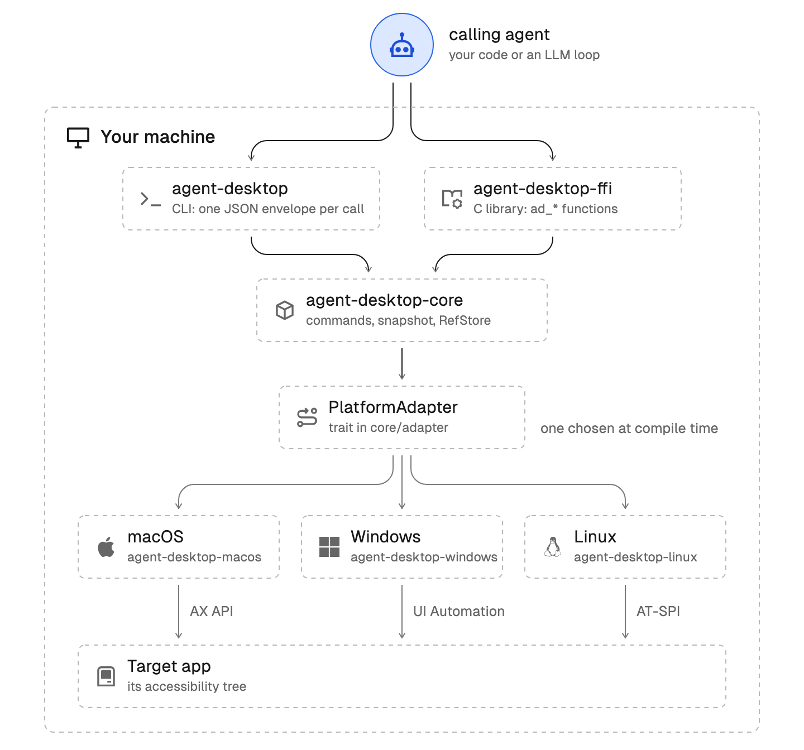

> **[中文化] agent-desktop**
>
> 此项目是 [vercel-labs/agent-desktop](https://github.com/vercel-labs/agent-desktop) 的中文翻译版本。
> - 原项目 Stars: 14547
> - 主语言: Rust
> - 许可证: Apache-2.0
> - 翻译日期: 2026-11-05
> - 原始 README: [README_en.md](README_en.md)
>
> 说明：下方 README 正文为**原项目文档的中文翻译**，力求忠于原文；本页顶部的「中文快速上手」为**面向中文用户的补充导读**（非原文内容），目的是让你不用读完整篇 README 就能先把项目跑起来。
>
> 如有翻译不准确之处，欢迎提 Issue 或 PR。

---


## 🚀 中文快速上手（补充导读，非原文）

### 这是什么 / 解决什么问题

agent-desktop 是 Vercel Labs 出的一个工具，让 AI agent 能"看见"并操作桌面应用——它不靠截图或像素匹配，而是读取操作系统的无障碍树（accessibility tree），把界面元素以 JSON 返回，每个可操作元素带一个 ref，agent 通过 ref 点击或输入，再重新读取界面验证结果。它本身不含模型，只提供 CLI 和 C 库，操作循环由调用它的 agent 自己实现。适用于 macOS、Windows 和 Linux。

### 快速上手（最短路径）

1. 安装（需 Node 18+）：
   ```bash
   npm install -g agent-desktop
   ```
2. 检查平台、权限和支持的界面：
   ```bash
   agent-desktop status
   ```
3. macOS 用户按引导授予辅助功能权限：
   ```bash
   agent-desktop permissions --guide
   ```
4. 对某个应用做快照，只取可交互元素（每个带 ref）：
   ```bash
   agent-desktop snapshot --app Finder -i
   ```
5. 用上一步快照里的 ref 执行操作，然后再快照一次验证：
   ```bash
   agent-desktop click @s8f3k2p9:e8
   agent-desktop snapshot --app Finder -i
   ```

### 环境要求

- **操作系统**：macOS、Windows、Linux（README 平台支持表在此处被截断，具体各平台要求「原文未说明」）。
- **架构**：x64 和 ARM64。
- **依赖**：npm 安装方式需要 Node 18 或更高版本；也可用 pnpm、Yarn、Bun 安装同一包。
- **其他安装方式**：macOS/Linux 可用 Homebrew（`brew install agent-desktop`）；或从 GitHub Releases 下载对应原生归档；或从源码构建（需 Rust，`Cargo.toml` 标注 `rust-version = "1.89"`、edition 2024）。
- **国内网络提示**：材料未提及镜像源，npm 安装如遇网络问题可自行考虑更换 npm 镜像源。

### 常见坑与注意事项

- **ref 必须带快照 id**：裸写 `@e8` 会报 `INVALID_ARGS`；界面变化后操作会返回 `STALE_REF` 或 `AMBIGUOUS_TARGET`，需重新快照并用新 ref。
- **PowerShell 要加引号**：每个 ref 都要写成 `'@s8f3k2p9:e8'`，因为裸 `@token` 在 PowerShell 里是 splatting 运算符。
- **npm 安装脚本可能被拦截**：`postinstall` 被阻止时每次调用会多约 125ms，需用 `--allow-scripts=agent-desktop` 重新安装（项目内安装另有 `npm install-scripts approve` 流程）。
- **隐私风险**：快照、剪贴板读取、截图、命令输出和调试产物可能包含私人桌面内容，不要放进公开日志或上传。
- **macOS 需授权**：需通过 `agent-desktop permissions --guide` 授予辅助功能权限，否则无法读取界面。

---


---

# agent-desktop

面向 AI 智能体的计算机操作：通过操作系统无障碍树，在 macOS、Windows 和 Linux 上查看并操作桌面应用。

<p>
  <a href="https://vercel.com/labs#labs-products"></a>
  <a href="https://www.npmjs.com/package/agent-desktop"></a>
  <a href="https://github.com/vercel-labs/agent-desktop/blob/main/LICENSE"></a>
  <a href="https://www.npmjs.com/package/agent-desktop"></a>
</p>

agent-desktop 让 AI 智能体无需截图或像素匹配即可操作计算机。它读取桌面应用的无障碍树并以 JSON 返回，每个可操作元素都带一个 ref。智能体通过 ref 点击或输入，再次读取 UI 检查结果，然后重复。循环逻辑在你的智能体中；agent-desktop 内部不含模型。它以 CLI 和 C 库的形式发布。

快照、剪贴板读取、截图、命令输出和调试产物可能包含私密桌面内容。请勿将其放入公开日志或上传。

## 安装

```bash
npm install -g agent-desktop
agent-desktop status                # 平台、权限、支持的界面
agent-desktop permissions --guide   # macOS：引导你完成辅助功能授权
```

Bun、Yarn 和 pnpm 也可安装同一包。它包含 x64 和 ARM64 的原生二进制文件和平台辅助程序。
如需不通过 JavaScript 启动器直接执行，请从
[GitHub Releases](https://github.com/vercel-labs/agent-desktop/releases) 下载匹配的原生归档，并将辅助程序放在可执行文件旁边。

在 macOS 和 Linux 上，也可使用 Homebrew：`brew install agent-desktop`。目前尚无官方 Scoop 包。
仓库不再维护自定义 Homebrew tap 或 Scoop bucket。

发布归档和从源码构建详见[安装](https://agent-browser.dev/desktop/installation)。

## 快速开始

```bash
agent-desktop snapshot --app Finder -i      # 交互元素，每个带一个 ref
agent-desktop click @s8f3k2p9:e8            # 对该快照中的 ref 执行操作
agent-desktop snapshot --app Finder -i      # 再次观察以验证
```

每条命令输出一个 JSON 信封。精简快照如下：

```json
{
  "version": "2.6",
  "ok": true,
  "command": "snapshot",
  "data": {
    "app": "Finder",
    "snapshot_id": "s8f3k2p9",
    "ref_count": 59,
    "complete": true,
    "tree": {
      "role": "window",
      "name": "Downloads",
      "children": [
        { "role": "treeitem", "name": "Documents", "ref_id": "@s8f3k2p9:e8", "available_actions": ["Click"] }
      ]
    }
  }
}
```

- ref 携带其快照 id。裸 `@e8` 会以 `INVALID_ARGS` 失败。
- 若 UI 已变化，操作会返回 `STALE_REF` 或 `AMBIGUOUS_TARGET`。请重新快照并使用其 ref。
- 操作默认无头：不移动指针，不改变焦点。传 `--headed` 使用物理输入。
- 在 PowerShell 中，每个 ref 都要加引号（`'@s8f3k2p9:e8'`），因为裸 `@token` 是 splatting 运算符。

完整演练见[快速开始](https://agent-browser.dev/desktop/quick-start)。

## 工作原理

<picture>
  <source media="(prefers-color-scheme: dark)" srcset="assets/architecture-dark.png">
  
</picture>

你的智能体调用 CLI，或进程内调用 C 库。两者运行同一核心，核心仅通过 `PlatformAdapter` 访问操作系统。每个二进制文件针对一个操作系统构建，并与该系统的无障碍 API 通信。

## 面向 AI 智能体

二进制文件自带与其版本匹配的指南：

```bash
agent-desktop skills get desktop      # 循环、ref、验证和重试规则
agent-desktop skills get platform     # 你所运行系统上的差异
agent-desktop <command> --help        # 单条命令的标志
```

从 [skills.sh](https://skills.sh/vercel-labs/agent-desktop/agent-desktop) 将技能安装到智能体框架：

```bash
npx skills add https://github.com/vercel-labs/agent-desktop --skill agent-desktop
```

或将以下内容加入你的 `AGENTS.md`：

```markdown
使用 `agent-desktop` 查看并操作桌面应用。首次使用前，运行
`agent-desktop skills get desktop` 和 `agent-desktop skills get platform`，并遵循其指引。
```

仅当 `error.disposition.retry` 为 `safe` 时才重试失败的命令。信封、错误码和退出码见 [JSON 输出](https://agent-browser.dev/desktop/json-output)。

### MCP

`agent-desktop mcp` 通过 stdio 将每条命令作为 MCP 工具提供。工具以其命令命名（`desktop_snapshot`、`desktop_click`、`desktop_session_start`），接受该命令的参数，并返回其 JSON 信封：

```json
{ "mcpServers": { "agent-desktop": { "command": "agent-desktop", "args": ["mcp"] } } }
```

传给 `mcp` 的全局标志（如 `--session`、`--headed` 或 `--trace`）适用于每次调用。

## 命令

agent-desktop 有 60 个命令名，56 个可操作命令。其余四个（`key-down`、`key-up`、`mouse-down`、`mouse-up`）在守护进程能释放按住的键或按钮之前拒绝运行。[命令](https://agent-browser.dev/desktop/commands)文档记录了每一条。

| 分组 | 命令 |
|---|---|
| 观察 | `snapshot`、`find`、`get`、`is`、`screenshot`、`list-surfaces` |
| 对 ref 操作 | `click`、`double-click`、`triple-click`、`right-click`、`type`、`set-value`、`clear`、`focus`、`select`、`toggle`、`check`、`uncheck`、`expand`、`collapse`、`scroll`、`scroll-to` |
| 键盘和鼠标 | `press`、`hover`、`drag`、`mouse-move`、`mouse-click`、`mouse-wheel`、`key-down`、`key-up`、`mouse-down`、`mouse-up` |
| 应用和窗口 | `launch`、`close-app`、`list-apps`、`list-windows`、`list-displays`、`focus-window`、`resize-window`、`move-window`、`minimize`、`maximize`、`restore`、`open-system-surface` |
| 通知 | `list-notifications`、`dismiss-notification`、`dismiss-all-notifications`、`notification-action` |
| 剪贴板 | `clipboard-get`、`clipboard-set`、`clipboard-clear` |
| 等待 | `wait` |
| 会话 | `session`、`trace`、`cursor-overlay` |
| 系统 | `status`、`permissions`、`version`、`batch`、`skills` |

## 平台支持

| 平台 | 要求 | 无障碍 API |
|---|---|---|
| [macOS](https://agent-browser.dev/desktop/platforms/macos) | macOS 13 或更高，Intel 或 Apple Silicon | AX API |
| [Windows](https://agent-browser.dev/desktop/platforms/windows) | Windows 10 1809 或更高，x64 或 ARM64 | UI Automation |
| [Linux](https://agent-browser.dev/desktop/platforms/linux) | Ubuntu 24.04 或更高，x86_64 或 aarch64，X11 或 Wayland | AT-SPI |

各平台页面列出哪些功能可无头运行、哪些需要 `--headed`、哪些被拒绝。

## C 库

每个发布版本都附带 `libagent_desktop_ffi`，程序可在进程内调用 agent-desktop。见 [C 库文档](https://agent-browser.dev/desktop/ffi)。

```python
import ctypes
lib = ctypes.CDLL("./lib/libagent_desktop_ffi.dylib")
lib.ad_adapter_create.restype = ctypes.c_void_p
lib.ad_adapter_destroy.argtypes = [ctypes.c_void_p]
assert lib.ad_init(7) == 0  # 当头文件的 AD_ABI_VERSION_MAJOR 与库匹配时返回 AD_RESULT_OK
adapter = lib.ad_adapter_create()
lib.ad_adapter_destroy(adapter)
```

## 开发

每个平台适配器仅在其自身操作系统上构建，因此将 cargo 限定到宿主机的包。在 macOS 上：

```bash
HOST_PKGS=(-p agent-desktop-core -p agent-desktop-macos -p agent-desktop -p agent-desktop-ffi)
cargo test "${HOST_PKGS[@]}"
cargo clippy "${HOST_PKGS[@]}" --all-targets -- -D warnings
```

在 Windows 上，用 `agent-desktop-windows` 代替 `agent-desktop-macos`；在 Linux 上用 `agent-desktop-linux`。[CONTRIBUTING.md](CONTRIBUTING.md) 列出了所有检查项。

## 文档

- [简介](https://agent-browser.dev/desktop)：它是什么以及如何工作
- [快照和 ref](https://agent-browser.dev/desktop/snapshots-and-refs)
- [错误与恢复](https://agent-browser.dev/desktop/errors-and-recovery)
- [技能](https://agent-browser.dev/desktop/skills)
- [CONCEPTS.md](CONCEPTS.md)：词汇表
- [CONTRIBUTING.md](CONTRIBUTING.md)、[SECURITY.md](SECURITY.md)、[SUPPORT.md](SUPPORT.md)

## 许可证

Apache-2.0